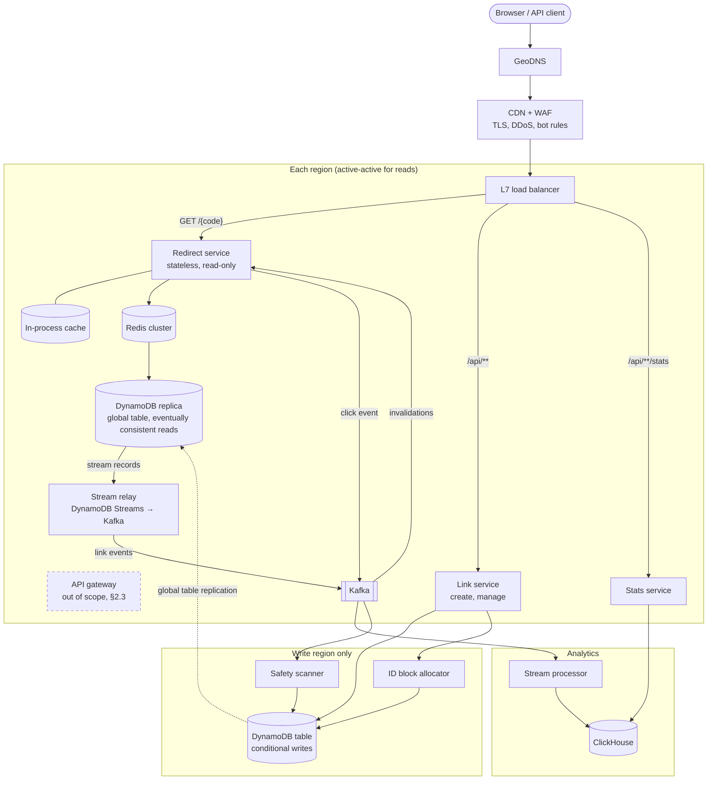
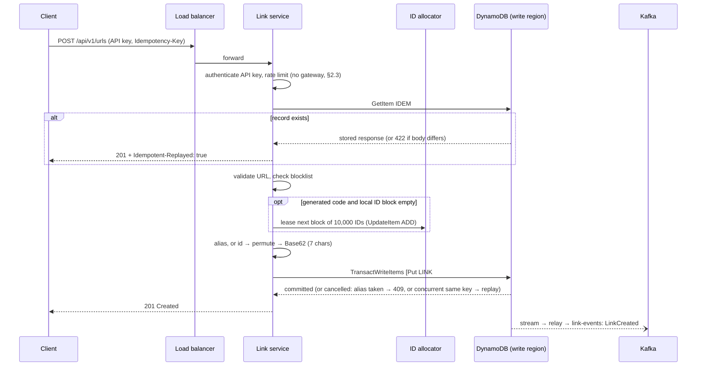
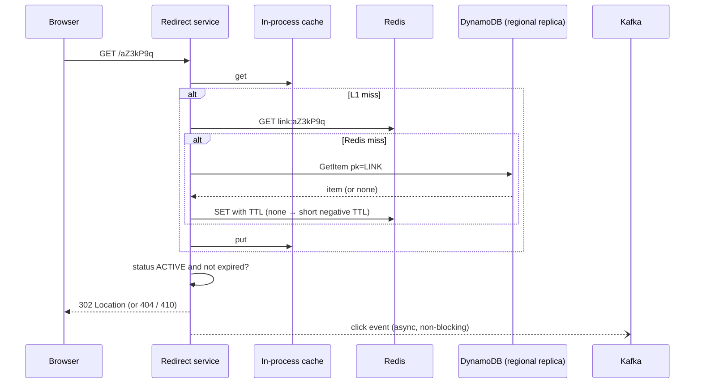
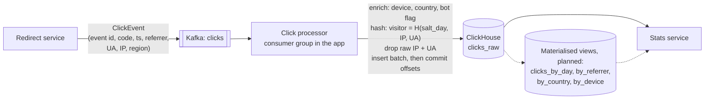

# Design: URL Shortener — End-to-End System Design

| | |
|---|---|
| **Version** | 2.0 — reviewed against the implementation |
| **Status** | Draft |
| **Last updated** | 2026-10-28 |
| **Scope** | The URL shortener service, designed end to end for production scale. This is the primary design document; implementation follows it. |
| **Stack** | Java 21, Spring Boot 4.1, Amazon DynamoDB, Redis, Kafka, ClickHouse, Kubernetes |

---

## 1. What Is a URL Shortener?

A URL shortener turns a long web address into a short one that redirects to it:

```
https://www.schwab.com/learn/story/how-to-build-a-diversified-portfolio?utm_source=newsletter&utm_campaign=oct
        ↓ shorten
https://sch.wb/aZ3kP9q
```

When someone opens the short link, the shortener looks up the code (`aZ3kP9q`), finds the original address and sends the browser an HTTP redirect to it. The visitor ends up on the original page, usually without noticing the extra hop.

**Why people use them:**

- **Shareability:** short links fit in SMS, social posts, printed material and QR codes, and are easier to read aloud or type.
- **Analytics:** because every click passes through the shortener, it can count clicks and report when, from where (referrer) and on what kind of device. Marketing teams use this to measure campaigns.
- **Control after publishing:** a link that's already printed or sent can be disabled, given an expiry, or (in some products) pointed somewhere else.
- **Branding:** a custom domain and alias (`sch.wb/research`) looks more trustworthy than a long tracking URL.

Well-known examples are Bitly, TinyURL and the `t.co` links on X.

**What makes it an interesting system design problem:** the core logic is a key-value lookup, but the traffic is extremely read-heavy and spiky, redirects must be fast and almost never fail, codes must be unique and short across billions of links, and every click produces an analytics event that has to be collected without slowing the redirect down. Shorteners are also attractive to spammers and phishers, so abuse prevention is part of the core design, not an add-on.

---

## 2. Requirements

### 2.1 Functional

| ID | Requirement |
|---|---|
| F1 | Create a short link for a long URL; optionally with a custom alias and an expiry |
| F2 | Redirect a short link to its long URL |
| F3 | Owners can view, list, update (expiry, status) and disable their links |
| F4 | Owners can see click analytics per link: totals, time series, referrers, device types, countries, unique visitors |
| F5 | Links that point to malicious destinations are blocked at creation and disabled if the destination becomes malicious later |
| F6 | Users authenticate with SSO (web) or API keys (programmatic) |

### 2.2 Non-functional

| Attribute | Target |
|---|---|
| Redirect availability | 99.99% per month (about 4.3 minutes of downtime) |
| Redirect latency (server-side, in region) | p50 < 5 ms, p99 < 50 ms |
| Create availability / latency | 99.9%; p99 < 300 ms |
| Analytics freshness | Clicks visible in stats within 1 minute (p95) |
| Durability | A created link is never lost (RPO 0 within a region, ≤ 1 min across regions) |
| Code properties | Short (7 characters), unique forever, not guessable in sequence (not yet met), never reused |
| Privacy | No raw IP addresses stored; raw click events kept 13 months, then aggregates only |

### 2.3 Out of Scope

Changing a link's destination after creation (it makes phishing easier and isn't needed for the use case), link-in-bio pages, A/B routing, and billing.

**API gateway.** Out of scope because of the assessment's limitations. Its duties move into the services, in every environment:

| Gateway duty | Where it's done instead |
|---|---|
| Authenticate API keys | Link and stats services, through `OwnerResolver` (§7.2, AP11) |
| Per-user and per-IP rate limits | Every `/api/**` request, through `RateLimiter` (package `ratelimit`), Redis-backed (§9) |
| Request IDs | The load balancer adds `X-Request-Id` |
| Routing `/api/**` to the right service | The load balancer |

---

## 3. Capacity Estimates

Assumptions: 100 million new links per month; 100 reads per write; 5 years of retention; peak traffic 5× average.

| Quantity | Calculation | Result |
|---|---|---|
| Writes (average) | 100M / (30 × 86,400 s) | ~40 / s |
| Writes (peak) | 40 × 5 | ~200 / s |
| Redirects (average) | 40 × 100 | ~4,000 / s |
| Redirects (peak) | 4,000 × 5 | **~20,000 / s** (design for 40,000 / s) |
| Links over 5 years | 100M × 12 × 5 | 6 billion |
| Link storage | 6B × ~500 bytes (document + indexes) | ~3 TB |
| Code space needed | 6B links | 62^7 ≈ 3.5 trillion codes is ~580× headroom |
| Click events | 10B / month × ~150 bytes raw | ~1.5 TB / month raw; ~150 GB compressed in a column store |
| Redirect cache | ~20M distinct links clicked per day × ~500 bytes | ~10 GB, fits in one Redis cluster |
| Bandwidth | 40,000 / s × ~500 bytes per response | ~20 MB / s, not a constraint |

**What this tells us:** the system is dominated by redirect reads, which must be served from cache; writes are modest and can go to a single write region; and analytics volume is two orders of magnitude larger than link data, so it needs its own pipeline and store.

---

## 4. API

All management endpoints are under `/api/v1`. Request and response bodies are JSON, errors use RFC 9457 `application/problem+json`, and the contract is published as OpenAPI 3.1.

| Method | Path | Purpose | Success | Errors |
|---|---|---|---|---|
| `POST` | `/api/v1/urls` | Create (supports `Idempotency-Key`) | `201` + `Location` | `400` invalid URL or alias, `409` alias taken, `422` blocked destination or `Idempotency-Key` reused with a different body, `429` rate limited |
| `GET` | `/{code}` | Redirect | `302` | `404` unknown (also returned, with no lookup, for a code that can't exist: not `[A-Za-z0-9_-]{3,32}`), `410` expired, disabled or deleted; `BLOCKED` links show a warning page instead; `503` + `Retry-After: 1` if the link isn't cached and DynamoDB fails |
| `GET` | `/api/v1/urls/{code}` | Metadata | `200` | `404`, `429` |
| `GET` | `/api/v1/urls?cursor=…&limit=50` | List the caller's links, newest first, cursor-paginated | `200` | `400`, `429` |
| `PATCH` | `/api/v1/urls/{code}` | Update expiry or status | `200` | `404`, `409`, `429` |
| `DELETE` | `/api/v1/urls/{code}` | Disable (soft delete) | `204` | `404`, `429` |
| `GET` | `/api/v1/urls/{code}/stats` | Click analytics | `200` | `404`, `429` |
| `POST` | `/api/v1/urls:batch` | Create up to 1,000 links in one request (campaign use). Not built yet | `200` | `400`, `429` |
| `GET` | `/actuator/health`, `/actuator/prometheus` | Health and metrics | `200` | |

Callers can only see and manage links they own; another owner's link returns `404`, not `403`, so codes can't be probed for existence.

**Rate limits.** Every `/api/**` request counts against three fixed one-minute windows: 300 per client IP (checked before the API key, so unauthenticated requests count too), and per owner 60 writes (`POST`, `PATCH`, `DELETE`) and 600 reads (`GET`). Over a limit the response is `429` with `Retry-After` in seconds until the window resets. Redirects aren't limited by the service; the CDN handles abuse there (§9).

Create request and response:

```json
// POST /api/v1/urls
// Idempotency-Key: 6f1c...   (optional)
{ "longUrl": "https://www.schwab.com/research", "customAlias": "research", "expiresAt": "2027-01-01T00:00:00Z" }

// 201 Created
{ "code": "research", "shortUrl": "https://sch.wb/research",
  "longUrl": "https://www.schwab.com/research",
  "createdAt": "2026-10-25T17:00:00Z", "expiresAt": "2027-01-01T00:00:00Z", "status": "ACTIVE" }
```

A repeated request with the same `Idempotency-Key` and body returns the original response with the header `Idempotent-Replayed: true`.

Stats response (`?from=…&to=…&granularity=DAY|HOUR&includeBots=false`):

```json
{ "code": "research", "totalClicks": 1243, "uniqueVisitors": 811,
  "series": [ { "bucket": "2026-10-24", "clicks": 512 }, { "bucket": "2026-10-25", "clicks": 731 } ],
  "topReferrers": [ { "host": "linkedin.com", "clicks": 402 } ],
  "byDeviceType": { "DESKTOP": 700, "MOBILE": 520, "OTHER": 23 },
  "byCountry": { "US": 1102, "GB": 141 } }
```

Redirect response:

```
HTTP/1.1 302 Found
Location: https://www.schwab.com/learn/story/...
Cache-Control: private, max-age=0
Referrer-Policy: unsafe-url
```

**Decision: `302`, not `301`.** Browsers cache `301` redirects permanently, so repeat clicks never reach the service and analytics undercount; expiry and disabling also stop working for anyone holding the cached redirect. `302` with `max-age=0` costs one extra round trip per click and keeps every click visible to the service.

---

## 5. High-Level Architecture



The dashed gateway is out of scope (§2.3): the load balancer routes `/api/**` straight to the link and stats services, which authenticate and rate-limit callers themselves.

### 5.1 Components

| Component | Responsibility | Scaling |
|---|---|---|
| **GeoDNS + CDN/WAF** | Routes users to the nearest healthy region; terminates TLS; absorbs DDoS; blocks known-bad bots | Managed service |
| **Redirect service** | `GET /{code}` only. Looks up the link (in-process cache → Redis → the region's DynamoDB replica), checks status and expiry, returns `302`, emits a click event | Stateless; horizontal autoscaling on requests per second. The largest fleet. |
| **Link service** | Create, list, update, disable. Authenticates API keys and applies rate limits (the gateway is out of scope, §2.3). Validates URLs, allocates codes, writes to DynamoDB in the write region with conditional writes | Stateless; small fleet; writes go to the write region |
| **Stats service** | Serves analytics queries from ClickHouse; checks the caller owns the link | Stateless |
| **API gateway** | **Out of scope (§2.3).** Would authenticate, rate-limit and add request IDs; the services and load balancer do this instead | — |
| **ID block allocator** | Hands out blocks of IDs to link service instances (§6.1) | One counter item updated with an atomic `ADD`; called once per 10,000 links per instance |
| **DynamoDB** | Source of truth for links, owners, API keys, idempotency records and the blocklist: one table plus one global secondary index (§7.1) | Managed; partitions split automatically. Global table with a replica in every region; writes only in the write region (§8) |
| **Stream relay** | Reads the region's DynamoDB Stream and publishes `LinkCreated` / `LinkUpdated` / `LinkDisabled` / `LinkBlocked` / `LinkDeleted` to Kafka | One per region, reading its own replica's stream. The Kinesis Client Library (DynamoDB Streams adapter) assigns stream shards to instances and checkpoints progress, so no custom leader election is needed |
| **Redis** | Shared redirect cache; rate-limit counters | Clustered, one per region |
| **Kafka** | `clicks` topic (high volume); `link-events` topic (created, updated, disabled, blocked, deleted) | `clicks` keyed by event ID, so one viral link's clicks spread over every partition; `link-events` keyed by code, so each link's changes stay in order |
| **Stream processor** | Enriches clicks (device type, country, bot flag, visitor hash) and batch-inserts them into ClickHouse, which deduplicates (§6.4) | A plain Kafka consumer group inside the app; scales with the number of `clicks` partitions |
| **ClickHouse** | Columnar store for click events and pre-aggregated rollups | Sharded and replicated |
| **Safety scanner** | Checks new and changed destinations against threat lists; periodically re-scans; disables links that become malicious | Consumes `link-events`; runs a scheduled re-scan |

**Decision: separate redirect and link services.** They have opposite profiles: the redirect path is 99% of traffic, read-only, latency-critical and must survive losing the write region; the link path is low-volume, write-heavy and needs the write region. Splitting them lets each scale, deploy and fail independently. They share the domain library, not a process.

**Locally, the three run as one app** because of local limitations: one Spring Boot application serves the redirect, link and stats endpoints. The code keeps them in separate packages (`redirect`, `link`, `stats`, shared `domain`) that never call each other directly, so splitting into three deployables later means moving packages into Maven modules, not rewriting them.

---

## 6. Core Flows

### 6.1 Create a Link



Without an `Idempotency-Key` the write is a single conditional `PutItem` instead of a transaction.

**Code generation:**

1. Each link service instance leases a block of 10,000 IDs from the allocator: `UpdateItem` on the `COUNTER#short_url` item with `ADD value :10000` and `ReturnValues: UPDATED_NEW`. The returned value `n` is the end of the block, so the instance owns `(n − 10000, n]`. Allocating an ID is then a local counter increment, with no database round trip and no coordination between instances. A crashed instance wastes the rest of its block; with 3.5 trillion codes that doesn't matter.
2. The ID is mapped through a fixed bijection over `[0, 62^7)`, the affine map `(a·id + b) mod 62^7` with `gcd(a, 62^7) = 1`, so consecutive IDs give unrelated-looking codes. This hides order from a casual look but isn't secret: two consecutive codes reveal `a`, after which every code can be listed in order. `a` and `b` can never change once codes are issued.
3. The result is Base62-encoded and left-padded to 7 characters.

**Custom aliases** must match `^[A-Za-z0-9_-]{3,32}$` and can't be a reserved path segment (`api`, `actuator`, `admin`, `health`, `login`, …). The alias is the item's partition key, and every link is written with the condition `attribute_not_exists(pk)`, so a duplicate fails with `ConditionalCheckFailedException` and returns `409`; no pre-check is needed. A generated code can only clash with an existing 7-character custom alias; the service then takes the next ID.

| Option | Collisions | Coordination | Guessable | Verdict |
|---|---|---|---|---|
| Random 7 chars + retry on conflict | Rare, rising as the space fills | DB unique check per write | No | Workable, but retries make latency unpredictable |
| Hash of URL (MD5, take 7 chars) | Yes, needs handling | DB check per write | No | Same URL always gets the same code, which leaks that someone else shortened it |
| Auto-increment + Base62 | No | Per write | Yes, sequential | Lets anyone enumerate every link |
| **Leased ID blocks + permutation + Base62** | **No** | **Once per 10,000** | **Not in sequence** | **Chosen** |

**Codes are never reused,** even after a link expires, is disabled or its owner is deleted. Reusing a code would send old printed links and bookmarks to someone else's destination. Link items are therefore never deleted: deletion leaves a tombstone (§7.2, AP19), and DynamoDB TTL is never set on link items.

**Same long URL twice:** each request gets a new code. Deduplicating would merge different owners' analytics and leak that a URL has been shortened before. An owner who wants one code per URL can use the idempotency key.

### 6.2 Redirect



- **Cache tiers:** an in-process cache (Caffeine, ~100k entries, 60 s TTL) absorbs the hottest links with no network hop; Redis (24 h TTL) holds the working set (~10 GB); the region's DynamoDB replica serves the rest with eventually consistent reads (half the cost of strongly consistent ones). The expected hit rate at Redis or better is above 99%.
- **The caches are load-bearing, not just an optimisation:** one DynamoDB partition serves at most 3,000 read units per second (6,000 eventually consistent reads), and a viral link is a single key on a single partition. Without the in-process and Redis tiers, one hot link at 40,000 redirects/s would be throttled.
- **Negative caching:** unknown codes are cached as "not found" for 30 s, so bots scanning random codes don't reach the database.
- **Thundering herd:** when a hot link misses, only one request per instance loads it (`Caffeine.get(key, loader)` coalesces concurrent loads); Redis entries get a small random TTL jitter so they don't all expire at once.
- **Expiry** is checked on every read using the cached `expires_at`, so it takes effect immediately whether or not the entry has been evicted.

### 6.3 Update, Disable and Cache Invalidation

Link changes are conditional `UpdateItem` calls in the write region (§7.2, AP7–AP8). DynamoDB Streams is enabled on the table with `NEW_AND_OLD_IMAGES`. In **each region**, a stream relay reads that region's replica stream, keeps only `LINK` items, and publishes `CREATED` / `UPDATED` / `DISABLED` / `BLOCKED` / `DELETED` events to the region's `link-events` topic, keyed by code. `CREATED` is included because the code may have been cached as "not found" before it existed. Every redirect instance has its own consumer group (`url-shortener-${HOSTNAME}`), so it receives every event: it evicts the code from its in-process cache and deletes the Redis key. Deleting a key more than once is harmless, so no single owner is needed.

- **Why one relay per region:** a replica's stream only shows a change once that replica has applied it. Evicting from the regional stream therefore guarantees the next cache miss reads the new value; evicting from the write region's stream could race replication and reload the stale item.
- **Worst-case staleness:** global-table replication (typically under 1 second) + stream and event delivery, normally under 2 seconds. The in-process cache TTL (60 s) bounds it if an event is lost.
- **Streams instead of a transactional outbox:** every committed write appears in the stream exactly once, in order per item, and the relay checkpoints only after publishing. A change therefore can't commit without eventually producing an event, which prevents the "disabled link still redirects" class of bug, with no outbox items or extra writes. Delivery to Kafka is at-least-once; consumers treat evictions as idempotent.
- **Relay outage:** stream records are kept for 24 hours. If a relay is down longer, it can't replay what it missed, so it invalidates the whole region's Redis link cache by bumping the key namespace (`link:v{n}:{code}` → `v{n+1}`); the old keys expire on their own, and in-process entries expire within 60 s.

### 6.4 Click Analytics Pipeline



- **Never blocks redirects (target):** the Kafka producer sends asynchronously with batching (`linger.ms` 20). If Kafka is unreachable, events wait in the producer's bounded buffer; when it fills, events are dropped and counted (`clicks.dropped`). **Gap:** `send` can block the calling thread for up to `max.block.ms` (500 ms) while the producer has no topic metadata or a full buffer, which is exactly what happens during a Kafka outage, so redirects slow down by up to 500 ms then.
- **Exactly-once results from at-least-once delivery:** each event has a UUID; ClickHouse uses `ReplacingMergeTree` with the UUID in its sorting key, and stats queries read with `FINAL`, so duplicates that haven't been merged yet aren't counted either. `FINAL` is cheap on one link's contiguous range (§7.5).
- **Privacy at the earliest point:** raw IP and user agent exist only in the `clicks` topic, which has 24-hour retention (`retention.ms`, set by `kafka-init` in `docker-compose.yml`). Everything stored long term has only derived fields and the daily-salted visitor hash.
- **Bots:** flagged by user-agent rules and behaviour (very high rate from one visitor hash). Bot clicks are stored but excluded from default stats; `?includeBots=true` shows them.
- **Retention:** `clicks_raw` 13 months (TTL in ClickHouse); rollups kept for the link's lifetime once they exist. Until then, stats older than 13 months are gone.
- **Unique visitors** are counted with `uniqCombined` (HyperLogLog-style, ~1% error) for fast queries over long ranges. Because the visitor-hash salt changes daily, one person visiting on three days counts as three; over ranges longer than a day the number is really visitor-days.

---

## 7. Data Design

### 7.1 DynamoDB Table (system of record)

All entities live in **one table**, `url_shortener`, with generic key attributes and one global secondary index. DynamoDB has no joins or ad-hoc queries, so the keys are designed from the access patterns in §7.2: every use case is a `GetItem`, a conditional write, or a `Query` on one partition.

**Table settings**

| Setting | Value | Why |
|---|---|---|
| Partition key / sort key | `pk` (S) / `sk` (S) | Generic names so several entity types share the table |
| GSI1 | `gsi1pk` (S) / `gsi1sk` (S); projection `INCLUDE`: `code`, `longUrl`, `status`, `createdAt`, `expiresAt`, `keyPrefix`, `revokedAt`, `reason` | Owner listings and the blocklist; a page is one `Query` with no follow-up reads |
| Capacity mode | On-demand | Spiky, unpredictable traffic; revisit provisioned + auto scaling once traffic is steady |
| Streams | `NEW_AND_OLD_IMAGES` | Cache invalidation, safety scanner, audit (§6.3) |
| TTL attribute | `ttl` (epoch seconds) | Set **only** on idempotency records; never on links (§6.1) |
| Global table | A replica in every region | Local reads everywhere (§8) |
| Point-in-time recovery | On (35 days) | Restore after bad writes (§8) |
| Encryption | KMS customer-managed key | Key rotation and access audit |
| Deletion protection | On | A dropped table would lose every link |

**Items**

| Entity | `pk` | `sk` | `gsi1pk` | `gsi1sk` | Other attributes |
|---|---|---|---|---|---|
| Link | `LINK#<code>` | `LINK` | `OWNER#<ownerId>` | `LINK#<createdAt>#<code>` | `code`, `seq` (absent for aliases), `longUrl` (≤ 2048 chars), `ownerId`, `status` (`ACTIVE` \| `DISABLED` \| `BLOCKED` \| `DELETED`), `createdAt`, `expiresAt` (optional), `updatedAt`, `version` (number, optimistic locking), `blockReason` (optional) |
| Link audit entry | `LINK#<code>` | `AUDIT#<timestamp>#<eventId>` | — | — | `action` (`UPDATED`, `DISABLED`, `BLOCKED`, `DELETED`), `actor` (owner ID, `scanner` or admin ID), `changes` (map of old → new). Creates aren't audited: the link item itself records `createdAt` and `ownerId`, and the destination never changes (decided 2026-10-28) |
| Owner | `OWNER#<ownerId>` | `OWNER` | — | — | `ownerId`, `externalSubject`, `createdAt`, `status` (`ACTIVE` \| `DELETED`), `verified` (bool, for batch create) |
| Subject → owner | `SUBJECT#<issuer>#<subject>` | `SUBJECT` | — | — | `ownerId`: makes the OIDC identity unique and maps it to one owner |
| API key | `APIKEY#<sha-256 of key>` | `APIKEY` | `OWNER#<ownerId>` | `APIKEY#<createdAt>` | `ownerId`, `keyPrefix` (first 8 chars, for display), `scopes`, `createdAt`, `revokedAt` (optional) |
| Idempotency record | `IDEM#<ownerId>#<sha-256 of Idempotency-Key>` | `IDEM` | — | — | `requestHash`, `status` (HTTP), `response` (map), `createdAt`, `ttl` (createdAt + 24 h) |
| ID counter | `COUNTER#short_url` | `COUNTER` | — | — | `value` (number) |
| Blocked host | `BLOCKEDHOST#<host>` | `BLOCKEDHOST` | `BLOCKLIST` | `<host>` | `reason`, `source` (`manual`, feed name), `addedAt` |

Example link item:

```json
{ "pk": "LINK#aZ3kP9q", "sk": "LINK",
  "gsi1pk": "OWNER#4f6c0b7e-…", "gsi1sk": "LINK#2026-10-25T17:00:00.000Z#aZ3kP9q",
  "code": "aZ3kP9q", "seq": 1042, "longUrl": "https://www.schwab.com/research",
  "ownerId": "4f6c0b7e-…", "status": "ACTIVE",
  "createdAt": "2026-10-25T17:00:00.000Z", "expiresAt": "2027-01-01T00:00:00.000Z",
  "updatedAt": "2026-10-25T17:00:00.000Z", "version": 1 }
```

**Rules that keep the data correct**

- **Timestamps** are ISO-8601 UTC strings with milliseconds, so they sort correctly as sort keys; `ttl` is the one epoch-seconds number, because DynamoDB TTL requires it.
- **Uniqueness** comes from conditional writes on the partition key: codes and aliases (`LINK#`), OIDC identities (`SUBJECT#`), idempotency keys (`IDEM#`).
- **No schema enforcement in the database.** DynamoDB only checks key attributes, so each entity has one mapper class that is the only code allowed to write it, with tests for its shape (`LinkItemMapper`, `IdempotencyRecordMapper`, `AuditEntryMapper`). They use the low-level `DynamoDbClient`. Items carry no type-specific fields outside that mapper.
- **Click counts are not stored here;** they live in ClickHouse, so redirects never write to DynamoDB.
- **Items stay small** (a link is ~400–600 bytes), so a write costs 1 write unit and an eventually consistent read costs 0.5 read units.

### 7.2 Access Patterns

Every use case and the single DynamoDB operation that serves it. Anything not in this table needs a new key design or index before it can be built.

| # | Use case | Operation | Key / index | Consistency | Errors |
|---|---|---|---|---|---|
| AP1 | Redirect lookup (cache miss) | `GetItem`, projection `longUrl, status, expiresAt` | `pk = LINK#<code>`, `sk = LINK` | Eventual, regional replica | Missing → `404`; `DISABLED`, `DELETED` or expired → `410`; `BLOCKED` → warning page |
| AP2 | Create with generated code | `PutItem` with `attribute_not_exists(pk)` | `LINK#<code>` | Strong (write region) | Condition fails → take next ID (clash with a 7-char alias) |
| AP3 | Create with custom alias | `PutItem` with `attribute_not_exists(pk)` | `LINK#<alias>` | Strong | Condition fails → `409` |
| AP4 | Idempotent create | `GetItem` on `IDEM#…`, then `TransactWriteItems`: Put link + Put idempotency record, both `attribute_not_exists(pk)` | `IDEM#<ownerId>#<keyHash>` + `LINK#<code>` | Strong | Record exists with another body → `422`; transaction cancelled on `IDEM` → concurrent request won, replay its response. Link and record are written atomically, so a key never maps to two links |
| AP5 | Lease an ID block | `UpdateItem ADD value :10000`, `ReturnValues: UPDATED_NEW` | `COUNTER#short_url` | Strong | — |
| AP6 | Get link metadata | `GetItem` | `LINK#<code>` | Strong | Missing or `ownerId` ≠ caller → `404` |
| AP7 | Update expiry or status | `TransactWriteItems`: `UpdateItem` on link with condition `ownerId = :caller AND version = :v AND status <> BLOCKED AND status <> DELETED`, `SET … version = version + 1, updatedAt = :now`, + Put audit entry | `LINK#<code>` | Strong | Condition fails: re-read the link (AP6) and try once more on the new version. The re-read reports `404` (not the owner) or `409` (`BLOCKED` or `DELETED`); losing a second race is `409` |
| AP8 | Disable (DELETE endpoint) | As AP7 with `SET status = DISABLED` | `LINK#<code>` | Strong | As AP7; already disabled → `204` (idempotent) |
| AP9 | List the caller's links, newest first | `Query`, `ScanIndexForward: false`, `Limit: 50`, `ExclusiveStartKey` from cursor | GSI1: `gsi1pk = OWNER#<ownerId>`, `begins_with(gsi1sk, "LINK#")` | Eventual (GSI) | Cursor is the last item's `gsi1sk` plus an HMAC bound to the caller. The owner always comes from the API key, never the cursor; an altered, forged or foreign cursor is `400` |
| AP10 | Batch create (≤ 1,000) | One conditional `PutItem` per link, 25 in parallel. `BatchWriteItem` isn't used because it doesn't support conditions, so it couldn't protect aliases | As AP2 / AP3 | Strong | Per-item result |
| AP11 | Authenticate an API key | `GetItem`, cached in-process for 60 s | `APIKEY#<sha-256>` | Eventual | Missing or `revokedAt` set → `401` |
| AP12 | Resolve OIDC user → owner | `GetItem` on `SUBJECT#…`; on first login `TransactWriteItems`: Put owner + Put subject, both `attribute_not_exists(pk)` | `SUBJECT#<issuer>#<subject>` | Strong | Concurrent first logins: the loser re-reads the subject item |
| AP13 | List an owner's API keys | `Query` | GSI1: `gsi1pk = OWNER#<ownerId>`, `begins_with(gsi1sk, "APIKEY#")` | Eventual | — |
| AP14 | Create / revoke an API key | `PutItem` with `attribute_not_exists(pk)` / `UpdateItem SET revokedAt` with `ownerId = :caller` | `APIKEY#<sha-256>` | Strong | Revoked keys stop working within the 60 s cache TTL |
| AP15 | Load the blocklist | `Query`, cached in-process, refreshed every 60 s | GSI1: `gsi1pk = BLOCKLIST` | Eventual | — |
| AP16 | Add or remove a blocked host | `PutItem` / `DeleteItem` | `BLOCKEDHOST#<host>` | Strong | — |
| AP17 | Scanner blocks a link | As AP7 with `SET status = BLOCKED, blockReason = :r`, condition `attribute_exists(pk)` (no owner or version check), + audit entry | `LINK#<code>` | Strong | — |
| AP18 | Weekly re-scan of all links | Export to S3 (point-in-time export, uses no table capacity), scanner reads the export | Whole table | Snapshot | A `Scan` of billions of items would compete with production traffic, so it isn't used |
| AP19 | Delete an owner (privacy) | `Query` GSI1 for the owner's links and keys; per link `UpdateItem` to a tombstone: `SET status = DELETED REMOVE longUrl, gsi1pk, gsi1sk`; delete API keys, subject item and owner item; delete the owner's rows in ClickHouse (lightweight `DELETE … WHERE code IN …`) | GSI1 `OWNER#<ownerId>` | Strong writes | The tombstone keeps the code taken forever and returns `410`, while removing the personal data |
| AP20 | Link history (support, investigations) | `Query`, newest first | `pk = LINK#<code>`, `begins_with(sk, "AUDIT#")` | Strong | Admins only |
| AP21 | Cache invalidation and scanner input | DynamoDB Streams (`NEW_AND_OLD_IMAGES`), filtered to `sk = LINK` | Table stream, per region | Ordered per item | §6.3 |
| AP22 | Stats | Not DynamoDB: AP6 checks ownership, then ClickHouse (§7.5) | — | — | — |

**Consistency notes**

- **Listing lags creation slightly.** GSI1 is updated asynchronously (normally well under a second), so a link created a moment ago may be missing from the first page. `GET /api/v1/urls/{code}` (AP6) is strongly consistent and always sees it. This replaces the separate `links_by_owner` write and its repair job: DynamoDB maintains the index itself.
- **Hot owner partitions.** An owner's links share one GSI1 partition key. A GSI partition accepts about 1,000 writes per second; a batch create from one owner runs at 25 parallel writes, far below that. If a single owner ever needs more, the GSI key gets a shard suffix (`OWNER#<ownerId>#<0–9>`) and listing queries the shards and merges them.
- **Transactions cost twice** the write units of single writes, so they're used only where atomicity is needed: idempotent creates, link changes with their audit entry, and first login.

### 7.3 Capacity and Cost

| Quantity | Calculation | Result |
|---|---|---|
| Peak writes | 200 creates/s × (1 table + 1 GSI write unit), ×2 for idempotent transactions | 400–800 write units/s |
| Peak reads | 40,000 redirects/s × < 1% cache misses × 0.5 read units | ~200 read units/s |
| ID leases | 200 creates/s ÷ 10,000 per lease | One counter update every ~50 s |
| Storage (5 years) | 6B links × ~500 bytes, plus GSI1 projection | ~3 TB table + ~2 TB index |

Storage, not throughput, is the main cost. Most links are rarely clicked after their first weeks, and reads are served from cache, so the **Standard-Infrequent Access** table class (cheaper storage, dearer reads and writes) is likely the better choice once storage dominates the bill.

**Decision: DynamoDB rather than MongoDB, Postgres or Cassandra.** The link store's access patterns (§7.2) are all single-key reads, single-item conditional writes and single-partition queries, which is exactly what DynamoDB is built for.

| Need | How DynamoDB meets it |
|---|---|
| Unique codes, aliases and identities | Conditional writes on the partition key |
| ID allocator | Atomic `ADD` on one counter item |
| Change events without an outbox | DynamoDB Streams, exactly once per change, ordered per item |
| Owner listings | A global secondary index, maintained by DynamoDB |
| Multi-region reads | Global tables, with a replica in every region |
| Recovery | Point-in-time recovery and exports to S3 |
| Operations | Fully managed: no shards, replica sets, patching or failover to run |

The costs are AWS lock-in, no ad-hoc queries (every new use case needs a key or index designed first, hence §7.2), eventually consistent secondary indexes, 24-hour stream retention, and a local emulator (DynamoDB Local) that doesn't match the service exactly. MongoDB would also fit, but needs a sharded cluster to be run or bought; Postgres needs an outbox table, failover tooling and sharding middleware; Cassandra can't enforce alias uniqueness without lightweight transactions.

### 7.4 Redis

| Key | Value | TTL |
|---|---|---|
| `link:v{n}:{code}` | `{longUrl, status, expiresAt}` or a not-found marker; `n` is the namespace version (§6.3) | 24 h (+ jitter); 30 s for not-found |
| `rl:{principal}:{window start, epoch seconds}`, where the principal is `ip:<sha-256 of IP>`, `owner:<ownerId>:read` or `owner:<ownerId>:write` | request count, incremented by a script that sets the TTL on the first increment | window length (1 min) |

Redis is a cache, not a source of truth: if it's lost, it refills from DynamoDB. Idempotency records live in DynamoDB rather than Redis, so a Redis failure can't make a retried create produce a second link.

### 7.5 ClickHouse

```sql
CREATE TABLE clicks_raw (
    event_id     UUID,
    code         String,
    ts           DateTime64(3, 'UTC'),
    referrer     LowCardinality(String),
    device       LowCardinality(String),
    country      LowCardinality(FixedString(2)),
    is_bot       UInt8,
    visitor_hash FixedString(16),
    region       LowCardinality(String)
) ENGINE = ReplacingMergeTree
PARTITION BY toYYYYMM(ts)
ORDER BY (code, ts, event_id)
TTL toDateTime(ts) + INTERVAL 13 MONTH;
```

Ordering by `(code, ts)` makes "clicks for this link in this range", the only query shape the stats API needs, read a contiguous range.

---

## 8. Multi-Region, Availability and Disaster Recovery

- **Reads are active-active:** the table is a DynamoDB global table with a replica in every region. Each region's redirect service reads its local replica with eventually consistent reads. GeoDNS sends users to the nearest healthy region and removes a region that fails health checks.
- **Writes go to one write region.** Every global-table replica accepts writes, but conditional checks are evaluated only in the region that receives the write, and concurrent writes to the same item in different regions are resolved by last writer wins. Two regions could therefore both accept the same alias, or lease the same ID block. Sending every write to one region keeps all the uniqueness guarantees in §7.2. At ~200 writes/s, a cross-region round trip (~70 ms) on create is acceptable.
- **Redirects never need the write region:** they read the local replica. If the local replica is also unavailable, cached links (>99% of traffic) keep working; only uncached links fail.
- **DynamoDB is regional and spread over three availability zones,** so there is no database primary to fail over within a region.

| Failure | Effect | Response |
|---|---|---|
| One redirect pod dies | None visible | Load balancer health checks; autoscaler replaces it |
| Redis cluster down in a region | Higher DynamoDB reads and latency | In-process cache absorbs hot links; the regional replica absorbs the rest (on-demand capacity scales up); a 200 ms timeout bounds each Redis call, and a circuit breaker (planned) stops calling it while it's down |
| Kafka down | Analytics delayed or partly lost; invalidations delayed | Redirects unaffected; bounded buffers; the stream relay resumes from its checkpoint (within 24 h of stream retention); in-process TTL limits staleness |
| DynamoDB throttling or errors in the write region | Creates and updates fail or slow down | SDK retries with exponential backoff and jitter; after that `503` with `Retry-After`; redirects unaffected |
| Whole write region down | Creates and updates fail; redirects served by every region | Switch the write region by configuration flag to a healthy region's replica. Before the new region leases IDs, it adds a safety margin (1,000,000) to the counter, because blocks leased just before the outage may not have replicated. RTO < 15 min; RPO = replication lag at the moment of failure, typically about a second |
| ClickHouse down | Stats unavailable | The click processor retries the batch with backoff (1 s up to 1 min) without committing offsets; events stay in Kafka and load when it recovers. Retention is 24 hours for privacy (§6.4), so a longer outage loses clicks |
| Malicious link spreading | Users sent to phishing | Disable → stream → event → evicted from all caches within seconds; flagged links show an interstitial warning page |

**Writes lost in a region failover.** An alias created in the old write region in the last second before it failed may not have replicated. If the same alias is created again in the new region, the old region's write arrives later and last writer wins. The relay detects this (a `LINK` stream record whose old image has a different `createdAt` and owner) and raises an alert for manual repair. It's rare enough that the design doesn't prevent it automatically.

Backups: DynamoDB point-in-time recovery (any second in the last 35 days, restores to a new table) and daily AWS Backup copies to a second region; ClickHouse backups to object storage daily. Restores are tested quarterly.

---

## 9. Security and Abuse Prevention

| Threat | Control |
|---|---|
| Phishing / malware destinations | Blocklist and threat-feed check on create; scanner re-checks new links after 1 hour and all links weekly; `BLOCKED` links return an interstitial warning instead of redirecting |
| Spam via mass link creation | Rate limits on every `/api/**` request (Redis-backed; no gateway, §2.3): 300/min per client IP, 60 writes and 600 reads/min per owner; they fail open if Redis is down; anonymous creation disabled in production; batch API limited to verified owners |
| Enumeration of links | Permuted, non-sequential codes (a keyed permutation is proposed); negative caching; rate limits on `404`s per IP at the CDN |
| Dangerous schemes | Only `http` and `https`; `javascript:`, `data:`, `file:` rejected; no links to the shortener's own domain |
| Account takeover / key leaks | OIDC for users; API keys stored hashed, shown once, revocable, scoped; secrets in a vault |
| Unauthorised access to analytics | Stats service checks ownership on every request |
| Personal data | No raw IPs stored beyond 24 h in Kafka; daily-salted visitor hash; 13-month retention; deletion of an owner tombstones their links (destination removed, code kept) and deletes their keys and analytics (§7.2, AP19) |
| Infrastructure | TLS everywhere, HSTS; each service has its own IAM role with least privilege: the redirect service may only `GetItem` on items whose key starts with `LINK#` (IAM condition `dynamodb:LeadingKeys`); only the link service and scanner can write; table encrypted with a customer-managed KMS key; every link change writes an audit entry (§7.2, AP20) |

---

## 10. Observability and Operations

**Service-level objectives and alerts:**

| SLO | Indicator | Alert |
|---|---|---|
| Redirect availability 99.99% | Non-`5xx` share of redirect responses (`404`/`410` count as success) | Multi-window error-budget burn rate (fast: 14× over 1 h; slow: 6× over 6 h) |
| Redirect latency | p99 < 50 ms | p99 > 50 ms for 10 min |
| Analytics freshness | Now minus newest event in ClickHouse | > 5 min |
| Invalidation delay | Time from DynamoDB write to cache eviction | > 30 s |

**Dashboards:** request rate, errors and latency (RED) per service; cache hit ratio per tier; Kafka consumer lag; DynamoDB consumed capacity, throttled requests and errors per operation; global-table `ReplicationLatency`; stream relay lag (age of the oldest unprocessed stream record); dropped click events; rate-limit rejections; links blocked per day.

**Tracing:** OpenTelemetry across load balancer → service → Redis/DynamoDB → Kafka, sampled at 1% for redirects and 100% for errors and creates.

**Deployment:**

- Kubernetes, one namespace per service, horizontal autoscaling on requests per second.
- Canary releases (5% → 25% → 100%) with automatic rollback when the canary's error rate or latency is worse than the baseline.
- The table, GSI1, stream, TTL setting and global-table replicas are defined as infrastructure as code (Terraform), reviewed like application code. The local environment creates the table from the same definition (§12).
- Item shape changes use **expand/contract**: deploy readers that accept both the old and new shape, then writers that write the new shape, backfill old items (from an S3 export, written back with conditional updates), and remove support for the old shape in a later release. No change ever breaks the running version. A new GSI is added online; DynamoDB backfills it while the table stays available.
- Feature flags for new behaviour (for example the interstitial page) so it can be turned off without a deploy.

---

## 11. Trade-offs Summary

| Decision | Chosen | Alternative | Why |
|---|---|---|---|
| Redirect status | `302`, no caching | `301` | Accurate analytics; expiry and disabling take effect |
| Code generation | Leased ID blocks + permutation | Random + retry, hashing | No collisions; no per-write coordination; not enumerable |
| Code reuse | Never | Recycle expired codes | Old links must never reach new destinations |
| Read/write split | Separate redirect and link services | One service | Independent scaling and failure isolation |
| Link store | DynamoDB global table | MongoDB, Postgres, Cassandra | Every access pattern is a single-key or single-partition operation; conditional writes for uniqueness; Streams replace the outbox; fully managed, no sharding to operate |
| Table layout | One table, one GSI | One table per entity | Fewer tables, one stream and one set of IaC; owner listings and keys share an index |
| Idempotency records | DynamoDB with TTL | Redis | Written atomically with the link, so a retry can never create a second link, even if Redis is lost |
| Cache | In-process + Redis | Redis only, or CDN caching of redirects | Sub-millisecond for hot links; caching redirects at the CDN would hide clicks and delay disabling |
| Analytics | Kafka → ClickHouse | Counters in DynamoDB or Redis | Volume is 100× link writes; flexible queries; isolation from the redirect path |
| Analytics guarantee | At-least-once with dedupe, bounded loss if Kafka is down | Synchronous, lossless | Redirect availability matters more than exact counts |
| Multi-region | Active-active reads, single write region | Writes in every region | Writes are low; conditional writes only protect uniqueness within one region (§8) |

---

## 12. Local Environment

The same architecture runs locally with one instance of each component (`docker compose up -d`). Only the deployment topology differs; the code paths are the same.

| Component | Local (`docker compose`) | Production |
|---|---|---|
| DynamoDB | One `amazon/dynamodb-local` container; a one-shot init job creates the table, GSI1 and stream from the same definition as production; the services use dummy credentials and an endpoint override | Global table, a replica in every region (§8) |
| Redis | One container, memory only, `allkeys-lru` | Clustered, one per region |
| Kafka | One broker in KRaft mode; topics created by a one-shot init job | Partitioned and replicated |
| ClickHouse | One container | Sharded and replicated |
| Services | One app serving redirect, link and stats endpoints, behind an nginx load balancer on `:8080`, 2 replicas | Three services (§5.1), Kubernetes, autoscaled per service |
| Stream relay | The same app with `APP_RELAY_ENABLED=true`, exactly one `relay` container, not behind the load balancer | One per region (§6.3) |
| API gateway | Out of scope (§2.3); the services authenticate and rate-limit callers | Out of scope (§2.3) |
| CDN, GeoDNS | Not run | Managed |

Each external dependency sits behind an interface in the domain, so tests can swap it and the production topology changes no domain code:

| Concern | Interface | Status |    
|---|---|---|
| Code IDs | `IdAllocator` | Built (`DynamoDbIdAllocator`) |
| Redirect cache | `LinkCache` | Built (`RedisLinkCache`) |
| Click recording | `ClickPublisher` | Built (`KafkaClickPublisher`) |
| Stats queries | `StatsRepository` | Built (`ClickHouseStatsRepository`) |
| Caller identity | `OwnerResolver` | Built (`ApiKeyOwnerResolver`) |
| Rate limiting | `RateLimiter` | Built (`RedisRateLimiter`) |
| Destination safety | `DestinationPolicy` | Planned; today `LinkValidator` checks a configured host list |

Cache invalidation has no interface of its own: the relay publishes with `KafkaTemplate` and `LinkEventsListener` consumes, so the transport is already isolated in those two classes.
